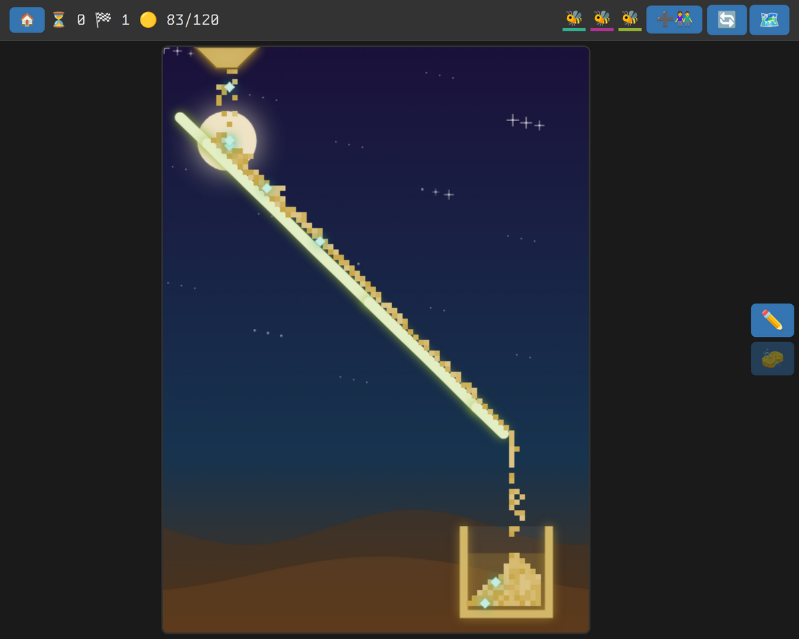

# Sand Sorter



Sand pours from the sky. Draw lines to catch it and roll it into the jar of its own color, before it all runs out. Fewer lines win more stars.

Ben dreamed this game up and keeps deciding what it does next; Claude, by way of [paude](https://github.com/fatlard1993/paude), does the building.

## Playing

- **Draw** with a finger or the mouse: a line catches sand the moment it's drawn. The **sponge** rubs lines out.
- **Fill each jar** with its own color. Wrong-color sand in a jar spoils the round, and the round ends when the sand runs out short.
- **47 levels** across eight worlds, easy to hard: paint boxes that change sand's color, wind, jars and walls that slide, big and tiny sand with a sieve to split them, ice, lava and water, monsters that sneak in to eat the sand, and a big final level with everything at once.
- **Play together**: anyone who joins draws in their own color on the same board. The ➕👫 button shows a QR code for a phone to join with.
- Tap a shooting star to make a wish.

## Running it

A multiplayer web game on [web-game-framework](https://github.com/fatlard1993/web-game-framework) and [@vanilla-bean/components](https://github.com/fatlard1993/vanilla-bean-components).

```sh
bun install
bun run dev
```

Then open http://localhost:3000, make a game, and join it from any device on the network. For production, `bun run build` then `bun start`.

- `sand.js` is the sand itself: how it falls, the levels, and the worlds they sit in.
- `Game.js` is one running game: its state and what each player's drawing does to it. The sand falls on the server, so every screen sees the same board.
- `server.js` runs the server and routes; `client/` is the page, with `Play.js` for the board.
- `data/games.json` holds the games between restarts.
